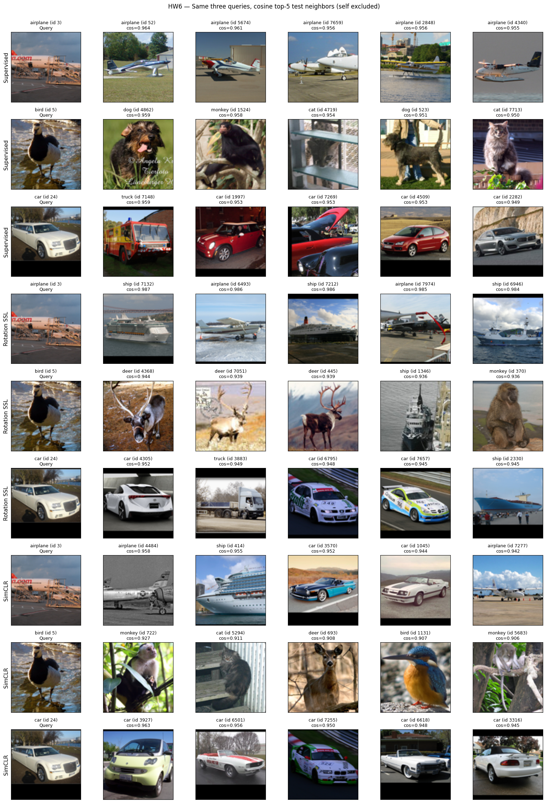
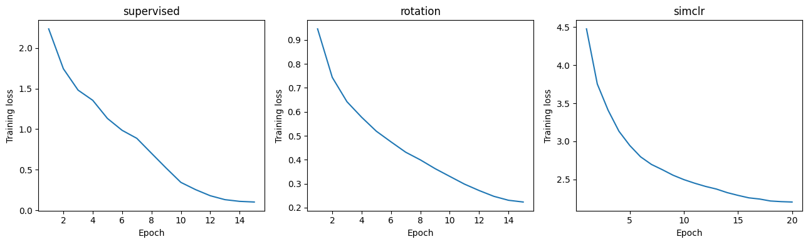

# Homework 6 findings

SID4: 6812 | SEED: 6812 | SLICE: 812 | HP_ID: 2 | CLS_A: 2 | CLS_B: 9

## Which model worked best?

SimCLR gave the best test accuracy at 51.79%. Rotation SSL reached 46.30%, and
the supervised model reached 43.60%. Both self-supervised models benefited from
unlabeled training in this run, although the experiment does not isolate why.
The architecture and labeled subset were shared, but the amount of pretraining
data and computation differed.

The supervised model's training loss fell from 2.2351 to 0.1029. Its test accuracy
was much lower than that low training loss might suggest. This is consistent with
overfitting: a ResNet-18 can fit a small set of 500 images without learning features
that generalize well. Stronger label-preserving augmentation and weight-decay
tuning could help. Any tuning should use validation data within the label budget,
not the test set.

Rotation pretraining improved accuracy by 2.70 percentage points over supervised
learning. Predicting orientation can encourage useful shape and spatial features,
but it does not require the model to distinguish object classes. Backgrounds and
horizons can also help solve the rotation task. This may explain why its features
helped classification somewhat while still producing several poor neighbors.
Adding crop augmentation to rotation training could discourage some shortcuts.
Longer pretraining is another option, although a lower rotation loss alone would
not guarantee better classification.

SimCLR encourages different views of one image to have similar representations.
That can make features less sensitive to changes in crop and appearance. This is
a plausible explanation for its better classification result, not proof of the
cause. More unlabeled images, a larger contrastive batch and longer pretraining
could improve it further. Crop strength also needs care because a small crop can
remove the object. These changes would need new experiments to evaluate.

## What the nearest neighbors showed

The same airplane, bird and car queries were used for all three models. Neighbors
were ranked by cosine similarity between encoder embeddings, with each query
excluded from its own results.

The supervised model retrieved five airplanes for the airplane query and four
cars plus one truck for the car query. However, none of its five neighbors for
the bird query were birds: it returned dogs, cats and a monkey. Its representation
therefore separated some examples well but failed on this bird example.

Rotation SSL returned two airplanes and three ships for the airplane query.
Several share broad horizontal shapes and sky or water backgrounds, suggesting
that scene structure may influence the similarity. Its bird query returned three
deer, a ship and a monkey. The car query returned three cars, a truck and a ship.
High cosine scores did not consistently mean the objects belonged to the same class.

SimCLR retrieved five cars for the car query, including cars with different colors
and viewpoints. That is a useful example of semantic grouping. Its airplane query
still mixed airplanes with a ship and cars. For the bird query, only one neighbor
was a bird; the others were a cat, deer and monkeys. Animal classes remained difficult
for this query even with the strongest classifier.

Supervised learning had the best mean query precision@5, at 60.00%, compared with
53.33% for SimCLR and 33.33% for rotation SSL. This does not contradict the test
accuracy ranking. Retrieval was assessed on only three queries, while classification
used all 8,000 test images. Local neighbor structure and linear classification also
measure different properties of the learned features.

## Training and experiment limits

All three pretraining/supervised loss curves decreased over the run. The linear
classifier losses also decreased overall. Loss values across different objectives
are not directly comparable.

This was one run with seed 6812, so it does not establish how stable the ranking is
across seeds. Rotation used 100,000 unlabeled images and SimCLR used 20,000; the
comparison was not matched for data or compute.

The four SimCLR augmentation types match the instructor's demo: random resized
crop, horizontal flip, color jitter and grayscale. This run used crop scale
(0.2, 1.0), while the demo used (0.6, 1.0). Color jitter was applied with probability
0.8 here rather than every time. The saved results correspond to these settings.
