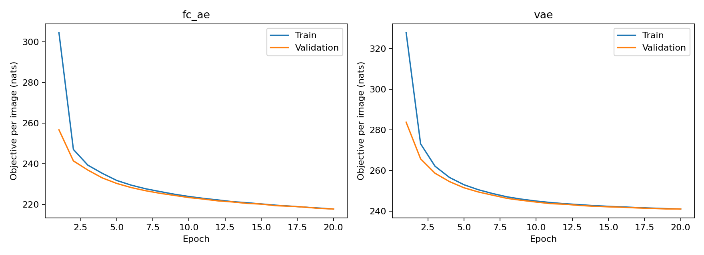
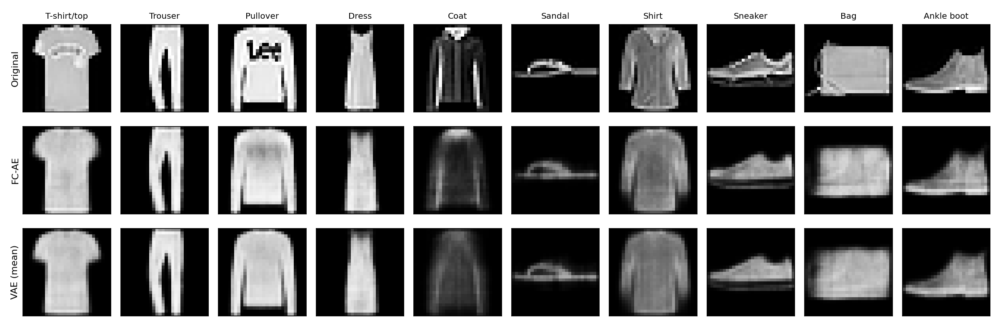
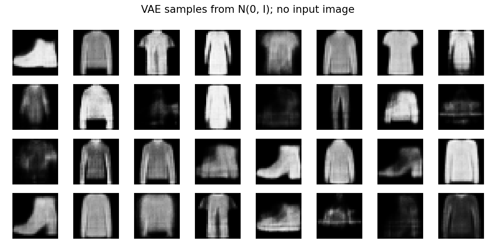

# Homework 7 — GANs and Autoencoders

**SID4: 6812 · SEED: 6812 · SLICE: 812 · HP_ID: 2 · CLS_A: 2 · CLS_B: 9**

This assignment explains GAN training, mode collapse, and three GAN variants. The practical section compares a fully connected autoencoder (FC-AE) and a variational autoencoder (VAE) on FashionMNIST in PyTorch.

## 1. The architecture of a GAN

A GAN contains two networks with competing objectives. The **generator**, G, transforms a random latent vector z into a synthetic example. The **discriminator**, D, receives either a real training example or a generated example and estimates the probability that it is real. The generator learns from the discriminator's feedback, without needing a target image paired with each random vector.

Training alternates between two updates. First, the discriminator learns to assign high scores to real examples and low scores to generated ones. Generated images are detached during this update, so the generator is not updated. Next, the discriminator's parameters are held fixed while the generator learns to increase the discriminator's scores for its images. Gradients still pass through the discriminator to the generator.

The original minimax objective is

$$\min_G\max_D\;\mathbb{E}_{x\sim p_{data}}[\log D(x)]+\mathbb{E}_{z\sim p_z}[\log(1-D(G(z)))].$$

In practice, the generator often minimizes the non-saturating loss, $-\mathbb{E}_z[\log D(G(z))]$, which provides stronger gradients when generated examples are easy to reject.

The theoretical goal is for the generated distribution to match the real distribution. For a fixed generator, the optimal discriminator is $D^*(x)=p_{data}(x)/(p_{data}(x)+p_g(x))$. Substituting it into the objective gives $-\log 4+2\,JS(p_{data}\Vert p_g)$. Its minimum occurs when the distributions match, and D outputs 1/2 on their common support. This assumes sufficient capacity and ideal optimization. A discriminator near 50% accuracy alone does not prove success; it could also be poorly trained. [Goodfellow et al., 2014](https://arxiv.org/abs/1406.2661)

## 2. Mode collapse

Mode collapse occurs when many different latent inputs produce the same output, or a small set of similar outputs, despite greater variety in the real data. For example, a FashionMNIST generator could produce convincing shoes but almost no shirts or bags. Good individual images would hide poor coverage of the data distribution.

The generator is rewarded for fooling the current discriminator. If one type of output receives a high score, mapping many latent vectors to it can be a useful short-term strategy. When the discriminator catches up, the generator may switch to another narrow group instead of learning the full distribution. Alternating optimization, limited discriminator capacity, and weak gradients can make this behavior difficult to escape. The ideal distribution-matching solution does not guarantee that practical optimization reaches it.

**Minibatch discrimination** lets the discriminator examine similarities among examples in a minibatch rather than judging every example independently. Repeated or nearly identical generated images become evidence of a fake batch. The generator then receives feedback about diversity as well as individual realism. This adds computation and depends on batch composition; it is not a guarantee of complete mode coverage. [Salimans et al., 2016](https://arxiv.org/abs/1606.03498)

**Unrolled GANs** optimize the generator against a discriminator after several simulated discriminator updates. Differentiating through those updates helps the generator anticipate how the discriminator would respond. A collapsed output becomes less attractive because the simulated discriminator can quickly learn to reject it. This reduces the reward for exploiting a temporary weakness, at the cost of extra computation and memory. The method improves stability and diversity in the reported experiments but is not a universal convergence guarantee. [Metz et al., 2016](https://arxiv.org/abs/1611.02163)

## 3. Three GAN variants

### DCGAN

DCGAN addresses the difficulty of learning image structure with early GAN architectures. It uses convolutional networks and architectural choices that improve image modeling and training behavior. Strided convolutions downsample in the discriminator, while transposed convolutions upsample in the generator. Batch normalization is used in many layers, along with ReLU activations in the generator, a tanh generator output, and LeakyReLU activations in the discriminator. Removing fully connected hidden layers and sharing convolutional filters gives the networks an inductive bias suited to spatial patterns. These choices improve image generation but do not eliminate mode collapse. [Radford et al., 2015](https://arxiv.org/abs/1511.06434)

### Conditional GAN

An unconditional GAN cannot directly choose which category to generate. A conditional GAN supplies information y, such as a class label, to both networks. The generator becomes G(z, y), and the discriminator evaluates D(x, y), judging whether the image is plausible for that condition. On FashionMNIST, a label could request a sandal instead of leaving the category to chance. Conditions can be concatenated with network inputs or represented using learned embeddings. Conditioning provides output control, although diversity can still collapse within a class. [Mirza and Osindero, 2014](https://arxiv.org/abs/1411.1784)

### CycleGAN

CycleGAN tackles image translation without paired examples, such as separate collections of horse and zebra photographs. It has two generators, G: X → Y and F: Y → X, and a discriminator for each domain. Adversarial losses encourage translated images to resemble the target domain. A cycle-consistency loss encourages $F(G(x))\approx x$ and $G(F(y))\approx y$, typically using L1 reconstruction penalties. This discourages mappings that ignore the input. Cycle consistency still does not guarantee the intended semantic translation, and major geometric changes can remain difficult. [Zhu et al., 2017](https://arxiv.org/abs/1703.10593)

## 4. Training autoencoders on FashionMNIST

FashionMNIST contains 28 × 28 grayscale images in ten clothing categories: 60,000 training images and 10,000 test images. Pixels are divided by 255 to obtain values in [0, 1]. A seeded random split reserves 5,000 training images for validation, leaving 55,000 for training. The official test set is evaluated after checkpoint selection. Labels are not training targets; they are used only for class-level metrics and selecting examples for the figure. [Official FashionMNIST dataset](https://github.com/zalandoresearch/fashion-mnist)

| Setting | FC-AE | VAE |
|---|---|---|
| Encoder | 784 → 256 → 128 → 32 | 784 → 256 → 128, then separate 32-dimensional mean and log-variance heads |
| Decoder | 32 → 128 → 256 → 784 | 32 → 128 → 256 → 784 |
| Hidden activation | ReLU | ReLU |
| Output | Logits; sigmoid for images | Logits; sigmoid for images |
| Optimizer | Adam, learning rate 0.001 | Adam, learning rate 0.001 |
| Batch size / epochs | 256 / 20 | 256 / 20 |
| Best checkpoint | Lowest validation BCE | Lowest validation BCE + KL |

Both models start from scratch and use the same split, minibatch ordering seed, decoder widths, and latent dimension. The VAE has an additional encoder head, so the parameter counts differ slightly. No second hyperparameter configuration is trained, as permitted in the assignment.

### FC-AE objective

The FC-AE compresses each image into a deterministic latent vector and reconstructs it. Its loss is binary cross-entropy (BCE), summed over all 784 pixels and averaged over examples. The implementation uses `binary_cross_entropy_with_logits` for numerical stability. Since grayscale intensities are continuous, BCE is used as a soft-target reconstruction criterion rather than an exact likelihood of continuous pixel observations.

### VAE objective

The VAE encoder predicts a diagonal Gaussian $q_\phi(z|x)=\mathcal{N}(\mu,\mathrm{diag}(\sigma^2))$. Sampling uses the reparameterization trick:

$$z=\mu+\exp(0.5\log\sigma^2)\odot\epsilon,\qquad\epsilon\sim\mathcal{N}(0,I).$$

This separates the random noise from learned parameters, allowing gradients to pass through the operation. The minimized objective is

$$\mathcal{L}=\mathrm{BCE}_{sum}(x,\hat{x})+D_{KL}(q_\phi(z|x)\Vert\mathcal{N}(0,I)),$$

$$D_{KL}=-\tfrac12\sum_j(1+\log\sigma_j^2-\mu_j^2-\sigma_j^2).$$

The KL weight stays at 1. Reconstruction loss is summed over pixels and KL is summed over latent dimensions; both are averaged over examples. The KL term encourages a latent distribution suitable for sampling new images, but regularization can reduce reconstruction fidelity. [Kingma and Welling, 2013](https://arxiv.org/abs/1312.6114)

### Evaluation

Both models are compared using per-pixel mean squared error (MSE), mean absolute error (MAE), and BCE on all 10,000 test images. Lower values are better. These are reconstruction measures, not classification accuracy or complete measures of generation quality.

VAE reconstruction metrics and pictures use the decoded posterior mean μ for repeatability. This is not the same as averaging images over the posterior. The VAE objective is evaluated separately using one posterior sample per image with a fixed seed. It estimates the reconstruction-plus-KL objective, not exact test likelihood. Its total should not be directly ranked against the FC-AE total because only the VAE includes KL.

### Recorded results

Both models completed 20 epochs on an NVIDIA GeForce GTX 1650 using Python 3.13.7, PyTorch 2.6.0+cu124, and torchvision 0.21.0+cu124. The successful run is recorded in `hw7_outputs/run.log`.

| Model | Selected epoch | Parameters | Test MSE | Test MAE | Test BCE/pixel |
|---|---:|---:|---:|---:|---:|
| FC-AE | 20 | 476,720 | 0.012105 | 0.057258 | 0.279904 |
| VAE (posterior mean) | 19 | 480,848 | 0.015484 | 0.065803 | 0.289328 |

For the VAE, the sampled test reconstruction BCE was **230.3322 nats/image**, the KL term was **12.5377 nats/image**, and their sum was **242.8699 nats/image**. These sampled values differ from the posterior-mean reconstruction metrics above.

The FC-AE had 21.8% lower test MSE than the VAE in this run. This fits the difference in objectives: the FC-AE focuses entirely on reconstructing its input, while the VAE also pays a penalty for moving its latent posterior away from the prior. This is evidence for this configuration and seed, not a claim that all FC-AEs outperform all VAEs.



Both objectives fall substantially early in training and then improve more slowly. Training and validation curves remain close, with no large overfitting gap in these 20 epochs. Training loss averages batches while weights are changing; validation uses the weights at the end of the epoch, which helps explain why validation is often lower. The FC-AE selected epoch 20; the VAE selected epoch 19 because its validation objective rose slightly at epoch 20.



The figure uses the first test example from each class, rather than selecting the best reconstructions. Both models preserve broad clothing shapes. The FC-AE keeps somewhat more detail in the coat and bag, while VAE outputs are smoother. Neither model accurately preserves the lettering on the pullover or the fine detail of the sandal. A low average pixel error does not mean every important detail survives.

| Class | FC-AE test MSE | VAE test MSE |
|---|---:|---:|
| T-shirt/top | 0.011067 | 0.014507 |
| Trouser | 0.006065 | 0.008391 |
| Pullover | 0.011517 | 0.014833 |
| Dress | 0.011140 | 0.014606 |
| Coat | 0.010726 | 0.013762 |
| Sandal | 0.018372 | 0.023365 |
| Shirt | 0.012063 | 0.014952 |
| Sneaker | 0.008907 | 0.011820 |
| Bag | 0.019209 | 0.023192 |
| Ankle boot | 0.011985 | 0.015412 |

Trousers have the lowest error for both models. Bags and sandals are among the hardest classes. Their higher errors suggest that detailed shapes and varied appearances are harder to capture with these compact fully connected models.



These 32 images are decoded from independent standard-normal latent vectors, without input images or class labels. Several resemble tops, trousers, and shoes, although some shapes are ambiguous and all have limited fine detail. This shows the VAE can generate new examples from its prior; it does not establish complete coverage of all classes. The FC-AE has no trained standard-normal latent prior, so decoding arbitrary normal vectors would not be an equivalent generation experiment.

A convolutional encoder and decoder would be a reasonable next experiment because they can exploit local image structure. Longer training or a different KL weight could also change the tradeoff. Neither modification was tested here. This comparison uses one seed and does not estimate variation across independent runs.

### Validation checks

Run `python hw7_validate.py` to check the analytic BCE and KL cases, split disjointness and coverage, VAE sampling gradients, finite checkpoint weights, and reproduction of the recorded full-test metrics from reloaded checkpoints.


## Reproducing the experiment

```bash
python -m pip install -r requirements.txt
python hw7.py
```

The Windows command used here is `py -3.13 hw7.py`. The script downloads FashionMNIST from its official GitHub mirror and checks torchvision's expected MD5 hashes. It uses CUDA when available and otherwise runs on CPU. `hw7_outputs/` contains model checkpoints, exact split indices, epoch histories, environment details, test metrics, figures, and the UTC timestamped training log. A new run overwrites the corresponding artifacts. Seeds and deterministic algorithms are enabled, but different hardware or library versions can still produce different results.

The checkpoints include model weights, optimizer states, selected epochs, and configuration. The script starts a fresh run; automatic resume is not implemented. `HW7.ipynb` contains the same implementation and is executed with `py -3.13 execute_hw7.py`. Its outputs include the training log, metrics, and figures. The script equivalent is `py -3.13 hw7.py`.

## Step 0 and submission status

The standing requirements from Assignment 1 apply here. All six personal parameters appear at the top of this report and in the first notebook cell. Only SEED is used because HW7 does not reference the other parameters or supply an HP_ID mapping. Python, NumPy, and PyTorch seeds are set explicitly; validation sampling and prior sampling also use SEED. HW7 explicitly waives the extra hyperparameter configuration. It does not require a separate six-item failure gallery or HW1's three-seed experiments.

The required artifacts are `HW7.ipynb`, `RUN_LOG.txt`, `METRICS.md`, `AI_USE.md`, the training code, and the checkpoints in `hw7_outputs/`. The required submission tag is `hw7`. The `.docx`/`.pdf`, TensorFlow, and CUDA requirements in the supplied Homework 1 page belong to Homework 1, not to the standing requirements for HW7.

The repository is `https://github.com/AkhileshTandur/data266-6812`. GitHub reported it as public during verification, so it does not yet satisfy the private-repository requirement. Publishing the final files, changing visibility, and confirming instructor/grader access remain separate from the local experiment. The AI-use appendix is an assisted draft and needs the student's own review and wording.

## AI assistance

ChatGPT/Codex assisted with the explanations, implementation, experiment execution, and validation. Reported metrics come from saved run artifacts. The student should review the work and be able to explain the objectives, sampling procedure, and evaluation choices before submitting.

One issue caught during execution was that validation metrics stored as NumPy scalars prevented loading a checkpoint with PyTorch's `weights_only=True` setting. The code now converts those metrics to Python floats before saving. The experiment was restarted after the correction, and checkpoint loading is included in `hw7_validate.py`.
