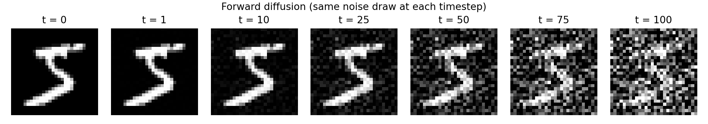
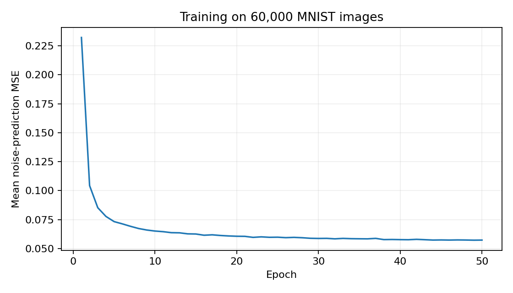
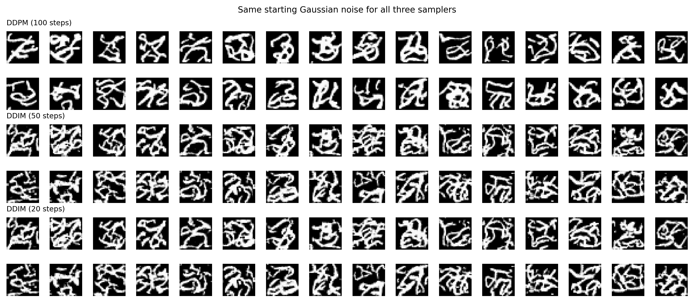

# Homework 8: Mini Diffusion Model

This experiment trains a small CNN to predict noise added to MNIST images, then uses that same network to generate images with DDPM and DDIM.

## Setup

The training set contains 60,000 handwritten digits. Pixel values are scaled from [0, 255] to [-1, 1]. The model uses 100 diffusion steps, with beta increasing linearly from 0.0001 to 0.02. Training uses Adam with a learning rate of 0.001, batch size 128, and 50 epochs. The random seed is 6812. The network has 156,001 parameters and was trained on an NVIDIA GeForce GTX 1650.

## Forward diffusion

For each timestep, alpha is 1 minus beta, and alpha-bar is the product of the alpha values up to that step. A noisy image is computed directly as

$$x_t=\sqrt{\bar\alpha_t}x_0+\sqrt{1-\bar\alpha_t}\epsilon,\qquad \epsilon\sim\mathcal N(0,I).$$

The digit is clear at the early steps. Noise gradually covers the background and makes the edges harder to distinguish. The same Gaussian noise draw is used across the panels so that the change in noise strength is easy to follow. These panels show samples from the forward marginals, not one sequential random trajectory.

## Noise prediction

The CNN has eight convolutional layers and SiLU activations. A learned embedding represents the timestep and is added to the hidden features. The network downsamples once, processes the smaller feature map, and upsamples back to 28 by 28. A skip connection carries features from the original resolution into the output block. The prediction has one channel, matching the input noise.

For every batch, the code samples a timestep for each image and adds fresh Gaussian noise. The loss is the mean squared error between the predicted noise and the noise that was actually added:

$$L=\mathbb E_{x_0,t,\epsilon}\left[\|\epsilon-\epsilon_\theta(x_t,t)\|^2\right].$$

## DDPM and DDIM

DDPM starts with Gaussian noise and performs all 100 reverse steps. Each step uses the network prediction to compute a less noisy image. The implementation uses the fixed posterior variance and adds fresh noise at each step except the final one.

$$\mu_\theta=\frac{1}{\sqrt{\alpha_t}}\left(x_t-\frac{\beta_t}{\sqrt{1-\bar\alpha_t}}\epsilon_\theta(x_t,t)\right),\qquad
\tilde\beta_t=\frac{1-\bar\alpha_{t-1}}{1-\bar\alpha_t}\beta_t.$$

The reverse update is $x_{t-1}=\mu_\theta+\sqrt{\tilde\beta_t}z$, where $z$ is standard Gaussian noise for $t>1$ and zero at $t=1$.

DDIM uses the same network but skips timesteps. It first estimates the clean image, then combines that estimate with the predicted noise at the next selected noise level. Here eta is zero, so DDIM adds no new random noise. Its output is fixed once the starting noise and model weights are fixed.

For a selected timestep $t$ and the next smaller timestep $s$, the update is

$$\hat x_0=\frac{x_t-\sqrt{1-\bar\alpha_t}\epsilon_\theta(x_t,t)}{\sqrt{\bar\alpha_t}},\qquad
x_s=\sqrt{\bar\alpha_s}\hat x_0+\sqrt{1-\bar\alpha_s}\epsilon_\theta(x_t,t).$$

The selected timesteps are evenly spaced from 100 to 1 and rounded to integers. The last update goes to the clean endpoint, $s=0$, where $\bar\alpha_0=1$.

The comparison uses 32 starting noise images shared across all three methods. DDPM makes 100 network calls; DDIM makes 50 or 20. Samples are clipped to [-1, 1] only when displayed.

## Discussion

The training loss dropped from **0.2322 in the first epoch to 0.0573 in epoch 50**. Most of the improvement happened early: by epoch 10, the loss was already 0.0651. After that, the curve flattened, with small fluctuations because each batch received newly sampled noise and timesteps. This shows that the network learned to predict much of the added noise, but it does not measure how convincing its generated digits are.

The generated images are the weaker part of this experiment. They have bright strokes and dark backgrounds, but many contain overlapping loops or extra branches instead of a readable digit. In this grid, DDPM tends to produce more solid strokes and fewer small fragments than DDIM. That is a visual observation from these 32 samples, not a measured image-quality score.

The two DDIM grids look very similar when comparing the same positions. Reducing the steps from 50 to 20 changes some edges and small details, but neither version solves the distorted shapes. I would not conclude from these results that 20 steps always gives the same quality as 50; both are limited by this model and training setup.

| Sampler | Network evaluations | Time for 32 images | Speed relative to DDPM |
| --- | ---: | ---: | ---: |
| DDPM | 100 | 0.373 s | 1.00× |
| DDIM | 50 | 0.164 s | 2.27× |
| DDIM | 20 | 0.081 s | 4.61× |

These are single-run timings on the GTX 1650 after a warm-up, with CUDA synchronization before and after sampling. They exclude plotting. The main benefit of DDIM here is lower sampling cost: it reuses the trained model while making fewer predictions. DDPM introduces new randomness during the reverse process; DDIM with eta equal to zero does not.

There is also a limitation in the assigned schedule. At step 100, **alpha-bar is about 0.3636**, so the coefficient on the original image is still about 0.603. The forward plot confirms that the digit has not disappeared. Training therefore ends with noisy images that retain substantial structure, while generation is required to start from pure Gaussian noise. That mismatch is a plausible contributor to the poor shapes, alongside the small network. This experiment does not isolate how much each factor contributes. The required schedule was kept unchanged.

The implementation demonstrates the difference between the two sampling procedures, but the samples are not clean MNIST-quality digits. A follow-up experiment could test a schedule whose terminal alpha-bar is closer to zero and a model that captures more of the whole image at once. Those changes were not used in the submitted comparison.

## Checks

The equation checks passed for the forward process, the clean endpoint, and both reverse samplers. With an exact noise predictor constructed from a known clean image, DDPM and DDIM recovered that image within floating-point tolerance. The checks also confirmed 100, 50, and 20 model evaluations, deterministic DDIM output for fixed starting noise, the prediction shape, and gradients reaching the timestep embedding. The notebook was executed successfully with the completed checkpoint and its figures saved in the output cells.

## Running the notebook

Open `HW8.ipynb` and run its cells in order. It contains the implementation as well as the figures and discussion. The training cell loads a saved checkpoint when one is present; otherwise it trains the model for 50 epochs. Delete `hw8_outputs/checkpoint.pt` before running if you want to retrain from scratch. `hw8.py` runs the same experiment from the command line, and `hw8_validate.py` checks the forward and reverse equations.

## References

- Ho, Jain, and Abbeel, [Denoising Diffusion Probabilistic Models](https://arxiv.org/abs/2006.11239), 2020.
- Song, Meng, and Ermon, [Denoising Diffusion Implicit Models](https://arxiv.org/abs/2010.02502), 2020.
