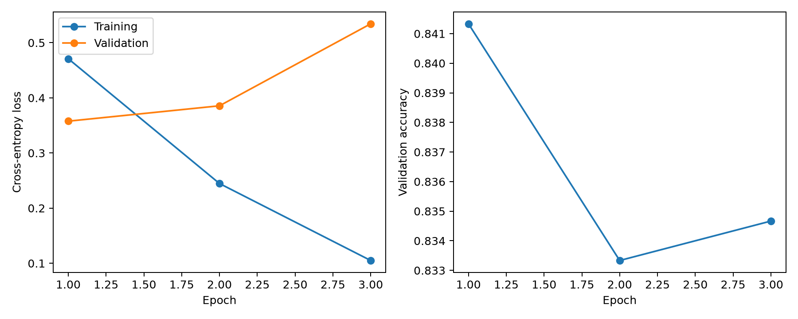
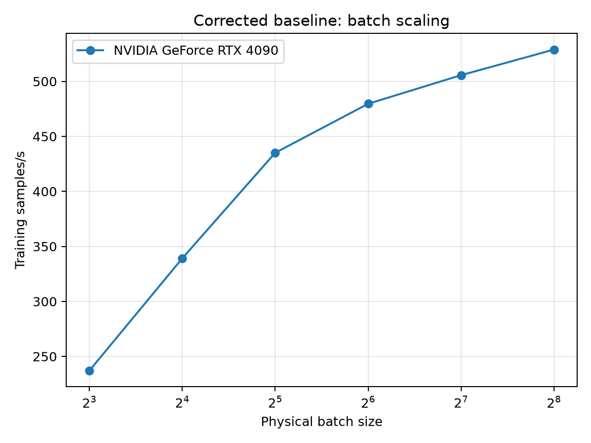
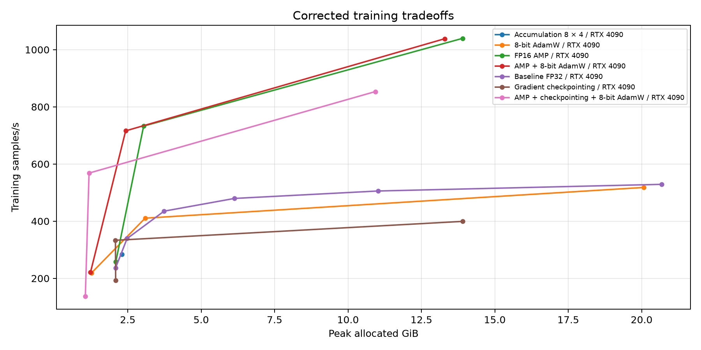
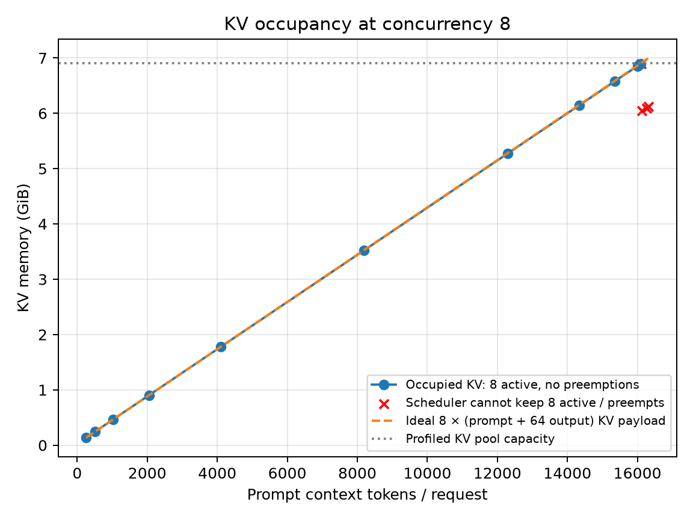

# HW4.5 — Training throughput and memory engineering

**RTX 4090 single-GPU study.** This submission uses the available hardware as requested. Two-card comparisons are marked not measured; Part C is an explicitly labelled one-rank DDP alternative. Hardware scope and the instructor-approval distinction are recorded in `SCOPE.md`.

## Data, hardware and reproducibility

The HW4 reference uses 5000 consecutive Sentiment140 source records, zero-based rows **797500–802499 inclusive**, excluding the CSV header. The selected range has 2,500 negative and 2,500 positive tweets. No source tweets were reordered or dropped before selecting this range. Configuration: SLICE=797500, SEED=42.

Sentiment140 is label-ordered, so source range 0–4999 is single-class and unsuitable for evaluating both sentiments. Exploratory single-class runs are excluded from the results in this report. Every reported Part A/B comparison uses the same two-class HW4 reference data, split, initialization and hyperparameters. The supplied selected-row CSV can reproduce the tensor datasets without downloading the full source; checksum verification rejects changed inputs.

Model `bert-base-uncased` at revision `86b5e0934494bd15c9632b12f734a8a67f723594`; `BertTokenizer` and `BertForSequenceClassification`; tensor datasets; fixed sequence length 128; three epochs; AdamW LR 2e-05, default weight decay 0.01; baseline physical batch 8, evaluation batch 8. SEED=42 is used for both `train_test_split` calls, initialization and training randomness. Train/validation/test sizes are 3500/750/750; the disjoint original-row indices are in `corrected/split_indices.csv`. Splits are shuffled, not stratified. Source SHA-256: `59d968893359b9f26f35a17fcdf92c01cb4922465ec72a0c7902225203093488`.

New runs execute in Ubuntu 24.04 on WSL2 with real CUDA access. The first uncapped batch-512 test encountered WDDM overcommit/paging. Subsequent runs enforce a resident allocator budget equal to **actual free device VRAM minus 64 MiB workspace headroom**, with exact free/budget bytes recorded per process. This replaces the earlier arbitrary 90% cap; it remains an explicit resident-memory budget, not a claim about the maximum pageable WDDM allocation. Earlier completed batches fit below this budget. CUDA OOM text and uncapped timeout evidence are retained separately. Each experiment is isolated; GPU training and serving benchmarks run sequentially. Exact versions and UUID captures are saved beside each card’s results.

Training throughput = all training samples across three epochs / sum of synchronized training-epoch times. Peak allocated/reserved memory is measured by PyTorch, in GiB (2^30 bytes), and excludes unrelated device allocations. Wall time includes training, per-epoch validation and final testing, excluding data/model loading and saving; external process elapsed time is also logged. Capacity probes perform three finite optimizer updates and are explicitly separate from full fine-tunes. AMP-skipped optimizer updates are recorded. First-epoch warmup is included consistently. There is one full run per configuration; small speed differences are observations, not statistically established gains.

## HW4 — Learning curves, class behavior and saved-model inference

HW4 reference on NVIDIA GeForce RTX 4090: final test accuracy **84.40%** (633/750), peak 2.0868 GiB, wall time 47.285 s, throughput 237.03 samples/s. These are HW4 measurements used only for this HW4.5 comparison, not an HW5 baseline.

| epoch | train_loss | val_loss | val_accuracy | training_seconds | samples_per_second |
| --- | --- | --- | --- | --- | --- |
| 1 | 0.4710 | 0.3577 | 0.8413 | 15.1804 | 230.5599 |
| 2 | 0.2447 | 0.3856 | 0.8333 | 14.9041 | 234.8351 |
| 3 | 0.1050 | 0.5343 | 0.8347 | 14.2130 | 246.2539 |

Lowest validation loss occurred at epoch 1; validation loss first stopped improving at epoch 2. Training continued for 2 additional epochs, costing 29.117 additional **training-only** seconds, plus validation overhead. Falling training loss with rising validation loss indicates overfitting. Final-epoch test metrics below are reported consistently; the final checkpoint is saved and can be reloaded with `infer.py --model corrected/NVIDIA_GeForce_RTX_4090/checkpoints/hw4_corrected_final`.

| True / predicted | negative | positive |
| --- | --- | --- |
| negative | 339 | 51 |
| positive | 66 | 294 |

| Class | precision | recall | f1-score | support |
| --- | --- | --- | --- | --- |
| negative | 0.8370 | 0.8692 | 0.8528 | 390.0000 |
| positive | 0.8522 | 0.8167 | 0.8340 | 360.0000 |

Worst class by recall: **positive**, recall 0.8167. The following are actual misclassified final-test examples from that true class. Diagnoses are plausible readings of the text, not proven explanations of model internals.

| Source row | Exact tweet | Diagnosis |
| --- | --- | --- |
| 800047 | I am bored  | The visible text expresses boredom; the positive weak label may depend on a removed emoticon or noisy supervision. |
| 802327 | my ex boyfriend once blamed me for making the freckles on his skin raise above the surface. he thought I'd done it to him.  i said wtf | The complaint and “wtf” sound negative; the positive label may reflect missing context or noisy weak supervision. |
| 802192 | I miss my boo thaaaaang  | “Miss” conveys absence, while the affectionate “boo” suggests a positive relationship; the model favors the negative cue. |
| 801475 | @Lyanna I couldn't agree more  | “Couldn’t agree more” is a positive idiom with negation; the model appears to miss the idiomatic meaning. |
| 802174 | Oh wow thats still sucky. Oh well atleast its later! Text me asap tomorrow  goodnight lover of mine  | Mixed sentiment includes “sucky” alongside an affectionate goodnight; the negative cue appears to dominate. |

Saved-model reload and custom inference (actual outputs from the corrected final checkpoint):

| text | negative_probability | positive_probability |
| --- | --- | --- |
| I loved the GPU lab today! | 0.0110 | 0.9890 |
| This was a frustrating day. | 0.9988 | 0.0012 |

## Part A — Batch scaling to the memory wall

### NVIDIA GeForce RTX 4090

| batch | throughput | peak_allocated_gib | avg_epoch_seconds | wall_seconds |
| --- | --- | --- | --- | --- |
| 8 | 237.0338 | 2.0868 | 14.7658 | 47.2848 |
| 16 | 339.1377 | 2.4768 | 10.3203 | 33.8658 |
| 32 | 435.0728 | 3.7365 | 8.0446 | 27.0676 |
| 64 | 479.6024 | 6.1340 | 7.2977 | 24.8468 |
| 128 | 505.6246 | 11.0261 | 6.9221 | 23.6994 |
| 256 | 528.8913 | 20.6821 | 6.6176 | 22.8230 |

Largest completed full-training batch: 256. Highest observed throughput: batch 256, 528.89 samples/s. Throughput did not stop improving before the measured memory boundary.

| batch | status |
| --- | --- |
| 512 | OOM |
| 512 | timeout |

Only one physical card was available, so a second-card curve, maximum-batch ratio, VRAM ratio and cross-card saturation comparison are not measured in this single-GPU study. In a two-card comparison the ratios need not agree: model/optimizer and driver allocations are fixed costs, activation memory grows with batch size, kernel workspaces depend on shape, and power-of-two testing quantizes the boundary. The measured RTX 4090 saturation conclusion above is confined to the tested batches.

## Part B — Independent memory techniques and combinations

Full-training rows at the largest completed batch are shown below; the maximum capacity-probe batch is also recorded separately. The techniques are applied independently before testing AMP + 8-bit AdamW and AMP + checkpointing + 8-bit AdamW. The comparison at effective batch 32 then attributes memory/throughput changes at a controlled batch. Accuracy is final-test accuracy; all configurations use three epochs.

### Table HW4.5.1 — NVIDIA GeForce RTX 4090

| Technique | Max completed full batch | Max passed probe batch | Effective batch | Samples/s | Peak GiB | Test accuracy |
| --- | --- | --- | --- | --- | --- | --- |
| Baseline FP32 | 256 | 256 | 256 | 528.8913 | 20.6821 | 0.8333 |
| FP16 AMP | 256 | 256 | 256 | 1039.7222 | 13.9053 | 0.8333 |
| Gradient checkpointing | 1024 | 1024 | 1024 | 399.3056 | 13.9044 | 0.7760 |
| Accumulation 8 × 4 | 8 | 8 | 32 | 284.2782 | 2.2976 | 0.8373 |
| 8-bit AdamW | 256 | 256 | 256 | 518.0620 | 20.0772 | 0.8293 |
| AMP + 8-bit AdamW | 256 | 256 | 256 | 1038.2741 | 13.2913 | 0.8347 |
| AMP + checkpointing + 8-bit AdamW | 1024 | 1024 | 1024 | 853.3557 | 10.9278 | 0.7680 |

Best tested combination for throughput: **AMP + 8-bit AdamW**, physical batch 256, 1038.27 samples/s, peak 13.291 GiB, final test accuracy 0.8347. This selects between the two measured combinations; it does not assert that combining every technique is fastest.

Memory saved per unit of throughput lost, ranked against FP32 physical batch 32:

| Technique | Physical batch | Effective batch | Saved GiB | Throughput change % | GiB / lost samples/s | Test accuracy |
| --- | --- | --- | --- | --- | --- | --- |
| FP16 AMP | 32 | 32 | 0.6959 | 68.4295 | No throughput loss | 0.8427 |
| 8-bit AdamW | 32 | 32 | 0.6444 | -5.6351 | 0.0263 | 0.8453 |
| Gradient checkpointing | 32 | 32 | 1.6556 | -23.4313 | 0.0162 | 0.8480 |
| Accumulation 8 × 4 | 8 | 32 | 1.4389 | -34.6596 | 0.0095 | 0.8373 |

At effective batch 32 I would apply **FP16 AMP** first based on this ranking; no-loss improvements rank ahead of techniques that sacrifice throughput.

Checkpointing at batch 32 changes throughput by -23.43% and saves 1.656 GiB. I would skip checkpointing on a 32 GB card when the desired batch already fits; at these small batches the recomputation cost buys unnecessary headroom. This is a workload choice, not an unmeasured 5090 speed claim.

Accumulation uses physical 8 × 4 = effective 32: 330 actual optimizer updates in 39.916 s versus physical batch 32: 330 updates in 27.068 s. Test accuracy 0.8373 versus 0.8440; peak allocation 2.298 versus 3.736 GiB. The final partial accumulation group is weighted by sample count.

## Part C — One-GPU DDP alternative

Topology: **single node, one RTX 4090, one process/rank**, NCCL backend. This follows the requested single-GPU adaptation; it does not assert instructor approval of an alternative to the original designated two-GPU requirement. There is no homogeneous/heterogeneous pair, no remote worker, and no inter-rank PCIe or network path. Ordinary training and actual `torchrun --standalone --nproc_per_node=1` DDP use the same data, initialization, optimizer and three-epoch schedule.

| Batch | Plain samples/s | DDP samples/s | One-rank relative efficiency % | DDP peak GiB | Signed sync−no_sync ms | DDP test accuracy |
| --- | --- | --- | --- | --- | --- | --- |
| 32 | 427.9060 | 402.2053 | 93.9938 | 4.1365 | 2.9173 | 0.8373 |
| 256 | 516.0704 | 511.0544 | 99.0280 | 21.0899 | 2.5268 | 0.8320 |

These supplementary comparisons were rerun after unrelated GPU jobs finished. Earlier contended attempts are retained as diagnostics and excluded from this table.

The percentage above is explicitly **one-rank relative efficiency**, T_DDP / (1 × T_plain), not two-GPU scaling efficiency. A two-card study would instead use T_DDP / (2 × T_single). There is no multi-GPU speedup or multi-GPU crossover batch to establish with one rank. The experiment measures framework/reducer overhead without adding physical compute capacity.

| Batch | Sync step ms | No-sync step ms | Signed difference ms | Difference SE ms | One-rank all_reduce API ms |
| --- | --- | --- | --- | --- | --- |
| 32 | 67.4807 | 64.5634 | 2.9173 | 0.3223 | 0.0122 |
| 256 | 470.2881 | 467.7613 | 2.5268 | 0.8795 | 0.0108 |

Communication measurement: the diagnostic alternates synchronized DDP and `no_sync()` backward passes for 30 pairs at fixed trained weights, after warmup. Its signed difference includes reducer/bookkeeping and timing noise; a negative value is retained rather than relabelled as a speedup or forced to zero. The separate all-reduce microbenchmark reports API latency only.

Actual inter-rank payload is **0 bytes/step** because no peer exists; effective inter-rank bandwidth is **N/A**, not buffer size divided by a one-rank no-op latency. There is no interconnect transfer to dominate computation. These measurements cannot answer heterogeneous-worker waiting or two-GPU communication efficiency; those original two-card items are explicitly outside this alternative.

For the memory-wall batch, unused optimizer state was freed after timed training and testing, before the forward/backward-only diagnostic. This avoids WDDM paging during that separate diagnostic; the reported full-training throughput, peak memory, wall time and accuracy were recorded before cleanup. The earlier pressure-affected diagnostic is archived and excluded from this comparison.

## Part D — vLLM and HF serving on real hardware

| Card | Configuration | Batch | Output tokens/s | p50 ms | p95 ms |
| --- | --- | --- | --- | --- | --- |
| NVIDIA GeForce RTX 4090 | hf | 1 | 46.4331 | 1371.5599 | 1424.5901 |
| NVIDIA GeForce RTX 4090 | vllm | 1 | 59.7634 | 1067.9360 | 1097.2487 |
| NVIDIA GeForce RTX 4090 | vllm | 8 | 446.8957 | 1137.5483 | 1164.4636 |
| NVIDIA GeForce RTX 4090 | vllm | 32 | 1495.5440 | 1350.5535 | 1410.4232 |

Serving model: `Qwen/Qwen2.5-7B-Instruct`, revision `a09a35458c702b33eeacc393d103063234e8bc28`, FP16, SEED=42. Prompt: “Explain in three sentences how gradient checkpointing changes GPU training memory and computation.” Both backends apply the same tokenizer chat template (45 input tokens) and generate exactly 64 output tokens per request. There are 20 measured repetitions per concurrency after warmup. Latency is individual client request completion time; aggregate throughput counts actual output tokens. Prefix caching is disabled for vLLM. Server flags, logs and software versions are saved with the serving results.

The first serving pass above establishes the corrected HW4 reference. A separate server run repeats it for HW4.5 below; both are newly collected after correcting the workflow, not represented as an unavailable historical vLLM run.

| Card | Batch | Repeat output tokens/s | Repeat p50 ms | Repeat p95 ms | Throughput change % |
| --- | --- | --- | --- | --- | --- |
| NVIDIA GeForce RTX 4090 | 1 | 59.3428 | 1078.9476 | 1100.7044 | -0.7039 |
| NVIDIA GeForce RTX 4090 | 8 | 443.9944 | 1142.8324 | 1175.4245 | -0.6492 |
| NVIDIA GeForce RTX 4090 | 32 | 1486.5390 | 1360.5975 | 1412.1528 | -0.6021 |

No tested concurrency satisfies both a higher p50 request latency than HF batch 1 and a throughput increase over the previous vLLM concurrency. This compares client completion latency rather than dividing batch latency by batch size. Interactive applications primarily care about individual request latency, especially p95; throughput determines capacity and GPU cost. The table is required to judge both, because higher aggregate throughput alone does not establish a responsive interactive service.

| Prompt context | Batch | Observed occupied KV GiB | Active requests observed | New preemptions | All requests succeeded |
| --- | --- | --- | --- | --- | --- |
| 256 | 8 | 0.1367 | 8.0000 | 0.0000 | True |
| 512 | 8 | 0.2461 | 8.0000 | 0.0000 | True |
| 1024 | 8 | 0.4649 | 8.0000 | 0.0000 | True |
| 2048 | 8 | 0.9025 | 8.0000 | 0.0000 | True |
| 4096 | 8 | 1.7767 | 8.0000 | 0.0000 | True |
| 8192 | 8 | 3.5227 | 8.0000 | 0.0000 | True |
| 12288 | 8 | 5.2712 | 8.0000 | 0.0000 | True |
| 14336 | 8 | 6.1446 | 8.0000 | 0.0000 | True |
| 15360 | 8 | 6.5821 | 8.0000 | 0.0000 | True |
| 16000 | 8 | 6.8539 | 8.0000 | 0.0000 | True |
| 16064 | 8 | 6.8812 | 8.0000 | 0.0000 | True |
| 16096 | 8 | 6.8949 | 8.0000 | 0.0000 | True |
| 16112 | 8 | 6.8983 | 8.0000 | 1.0000 | True |
| 16128 | 8 | 6.0463 | 7.0000 | 0.0000 | True |
| 16256 | 8 | 6.0941 | 7.0000 | 0.0000 | True |
| 16320 | 8 | 6.1181 | 7.0000 | 0.0000 | True |

Longest tested preemption-free prompt context at concurrency 8: **16096 tokens**, with 64 generated tokens. The next tested nonresident/preempting context is 16112; boundary resolution is 16 tokens. Criterion: all eight requests succeed, at least eight active requests observed, and no new cache preemptions. vLLM manages cache pressure by preempting or serializing requests, so this is a measured resident-cache boundary, not a fabricated CUDA allocation OOM. The engine limit is 16,384 total tokens, below the architecture’s 32,768 limit; the reported memory boundary is distinguished from these limits.

Occupied KV is measured from the server’s live cache-use gauge and actual profiled token-slot capacity, using FP16 payload geometry 2 × 28 layers × 4 KV heads × 128 head dimension × 2 bytes. Cache blocks contain 16 tokens. Samples arrive every 0.1 s and therefore provide a lower bound on instantaneous peak occupancy; reserved cache-pool VRAM is not mistaken for occupied payload. Raw metric samples, pool capacity and per-request results are included.

The historical Windows HF baseline was 35.2757 output tokens/s, p50 1813.8102 ms and p95 1848.0677 ms on this same 4090/model/FP16 precision. The new Linux HF rate is 46.4331 tokens/s (31.63% higher). The recorded software changed from Windows Torch 2.11.0/CUDA 12.8/Transformers 5.21.0 to WSL Linux Torch 2.13.0/CUDA 13.0/Transformers 5.19.0. This documents a changed execution stack, not a hardware or precision change; individual causes were not isolated. Earlier historical vLLM results were absent, so the corrected first/repeat passes above provide the explicit new HW4/HW4.5 comparison. No RTX 5090 serving measurements exist yet.

## Part E — Configuration and GPU hours

For a full fine-tune I would use **FP16 AMP, physical batch 256**, on NVIDIA GeForce RTX 4090. Among measured configurations whose final validation accuracy is within two percentage points of the corrected HW4 batch-8 baseline, this has the highest throughput. Validation, not test accuracy, is used for this selection. All tables report three-epoch runs; the observed validation plateau also motivates early stopping during a future full run.

Measured training-only GPU-hours for this three-epoch subset fine-tune = 3 × 3500 / 1039.7222 / 3600 = 0.002805. Including measured validation/test, 12.414/3600 = 0.003448 GPU-hours on one GPU. If extrapolated to 70% of the entire 1.6M-row source, 3 × 1,120,000 / 1039.7222 / 3600 = 0.8977 GPU-hours, assuming unchanged throughput and padding; that full-source estimate is not a measured result.

## Submission scope and evidence

This is the requested **single-GPU submission**. It includes measured training/serving results, raw records, figures, source, a saved trained classifier, reproducibility checks, GPU-hour records and GPU UUID captures. The captures show the same actual RTX 4090 at different stages; they are not represented as two different cards. Cross-card ratios, two-GPU scaling and inter-rank bandwidth are not measurable here and are disclosed in `SCOPE.md`.

The usage record in `RESERVATION.md` documents observed execution; a booking confirmation and formal instructor approval of the Part C alternative were not supplied and are not invented. Resident-budget boundaries are disclosed because WDDM permits paging. The original rubric’s two-card/approval conditions remain a scope exception for the assessor; the report does not claim to satisfy them with fabricated hardware. No course-site submission has been made.
